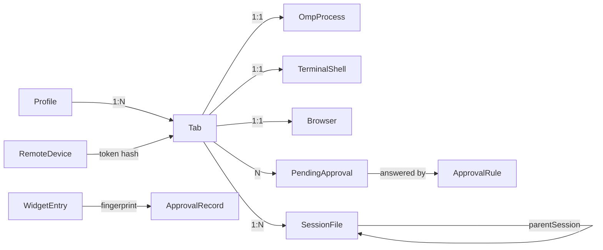

# 类型系统与数据模型

项目**没有** TypeScript。跨边界的数据形状靠三项约定维持：Serde 派生、JS 侧纯函数的显式建模、以及回归脚本。

## 序列化约定

| 约定 | 规则 |
|---|---|
| 命名 | Rust 侧一律 `#[serde(rename_all = "camelCase")]`；命令参数在 JS 侧写 camelCase |
| 注入防护 | 前端 → Rust 的请求结构体加 `deny_unknown_fields`（`StartSessionArgs` 是范例：webview **不能**传审批模式） |
| 枚举 | 直接序列化成裸字符串（`"Modified"`、`"Text"`），不包 `{type: …}` |
| 错误 | `Result<T, String>`；字符串会原样显示给用户 |
| 缺失 | `Option<T>` → `null` |

## 核心结构（逐层）

### 会话启动

```rust
// lib.rs:80 — deny_unknown_fields
struct StartSessionArgs { session_id, cwd, resume: Option<String>, profile: Option<String> }
```

返回 `String`：实际使用的审批模式（`"always-ask" | "write" | "yolo"`）。

### 终端（`terminal/wire.rs`）

```
TerminalStatus   { instance, shell, state: "starting"|"running"|"exited",
                   exitCode: number|null,
                   windowsPty: { backend:"conpty", buildNumber } | null }
ReplayWire       { instance, b64, headSeq, dropped }
TerminalSettings { shell, defaultShell, shells: [{ name, path }] }
```

`instance` 是**单调递增的壳实例号**（非会话 id），前端据此丢弃旧壳的事件。

### git 浏览器

```
StatusView { repo: RepoInfo, tree: TreeNode, changed, truncated }
RepoInfo   { name, branch: string|null, head: string|null, ahead: number|null, behind: number|null }
TreeNode   { name, path, dir, status: StatusKind|null, changed, children }
StatusKind = "Modified"|"Added"|"Deleted"|"Renamed"|"Untracked"

FileView { path, kind: "Text"|"Binary"|"Missing"|"TooLarge", status, adds, rems, lines[], truncated }
Line     { kind: "ctx"|"add"|"rem", old: number|null, new: number|null, text }

LogView  { rows: LogRow[], width, truncated }
LogRow   { id, short, parents[], subject, author, at, refs: Ref[], lane, edges: Edge[] }
Ref      { name, kind: "head"|"branch"|"remote"|"tag" }
Edge     { from, to }

CommitView { id, short, subject, body, author, email, at, parents[], tree: TreeNode, files, truncated }
```

**"状态"而非"错误"**：`FileView.kind` 与 `FilePreview.kind` 把 Missing/TooLarge/Outside 建模成状态；真正的 I/O 失败才是 `Err(String)`。

### 文件预览（`project_file.rs`）

```
FilePreview { path, size, kind: "Text"|"Image"|"Binary"|"TooLarge"|"Missing"|"Outside",
              text?, data?, mimeType? }
```

### widget 配置

```
WidgetConfig { plugins: PluginEntry[], errors: string[] }
PluginEntry  { id, title, command[], match, triggers, interval_ms, enabled, scope,
               insert: { target: "draft"|"new-tab", project } , attention }
```

### omp 侧（前端消费的帧）

`live.js` 只关心 `type`，不做 schema 校验（omp 是可信对端）。关键 `type`：

| 类别 | `type` |
|---|---|
| 生命周期 | `ready`、`response`、`rpc_chunk` |
| 消息 | `message_start`、`message_update`、`message_end` |
| 工具 | `tool_execution_start`、`tool_execution_update`、`tool_execution_end` |
| 回合 | `agent_start`、`agent_end`、`turn_start`、`turn_end`、`auto_retry_start`、`prompt_result`、`session_settled` |
| 交互 | `extension_ui_request`（`select`/`confirm`/`input`/`editor`/`ask`/`cancel`，以及 `setStatus`/`setWidget`/`notify` 等） |
| 子 agent | `subagent_lifecycle`、`subagent_progress`、`subagent_event` |
| 队列 / goal / 思考 | `queue_update`、`goal_updated`、`thinking_level_changed`、`config_update`、`session_info_update`、`available_commands_update` |
| 合成帧（Rust 产生） | `desktop_auto_approval` |

### 前端转录条目（`adapter.js` 产出）

```
UserEntry      { _id, role:"user", text, images[], ts?, echo? }
AssistantEntry { _id, role:"assistant", text, thinking[], tools[], ts?, failed?/retried?/aborted? }
ToolCard       { role:"tool", name, args, result, status, images?, targets?, bytes?, isError? }
AskEntry       { role:"ask", id, kind, title, options[], details[], closedByOmp? }
NoteEntry      { role:"note", text }        // 桌面自造，**永不**带 ts
RetryRow       { kind:"retry", attempt, maxAttempts, failed, phase }
JobRow         { kind:"job", … }
GoalRow        { kind:"goal", … }
```

**不变量**：桌面自造条目永不带 `ts`（`mergeTranscript` 靠 `(kind, ts)` 匹配 omp 消息；带 `ts` 会被错误合并）。

## 数据关系



| 关系 | 基数 | 键 |
|---|---|---|
| profile → 标签页 | 1:N | `profile.id`（`default` = 无 `--profile`） |
| 标签页 → omp/终端/浏览器 | 1:1:1 | 会话 id（`session-<ms>`） |
| 会话文件 → 父会话文件 | N:1 | `parentSession`（会话树的"家族"） |
| 待答提示 → 审批规则 | N:1 | `(sessionId, requestId)` 与 `(scope, tool)` |
| 远程设备 → 标签页 | N:M | 设备 token 的 SHA-256 |

## 类型边界的三个易错点

1. **`ts` 语义**：omp 消息的时间戳是合并键；UI 的"现在"是另一个字段（`time`）。混用会让切标签后的转录错位。
2. **`instance` vs `seq`**：终端用 `(instance, seq)` 双重判序；浏览器帧用 ack 计数。两者都不与 omp 的 journal `seq` 混用。
3. **`projectPath` 形式**：到达前端的路径必须是 Rust canonicalise 过的形式（`external_open::canonical_folder`）。Windows 盘符/UNC 比较忽略大小写，`normPath` 是唯一比较函数。

## 相关文档

→ 详见 [服务层与IPC通信](服务层与IPC通信.md)
→ 详见 [前端状态管理全景](前端状态管理全景.md)
